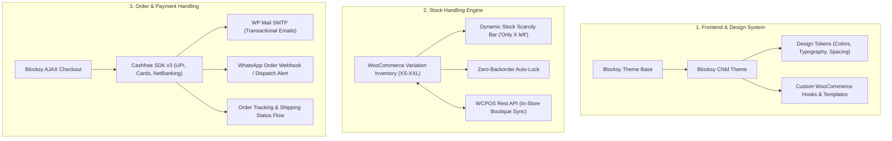

# 📋 BMAD Implementation Plan: Boutique Commerce Template

Based on the **BMAD (Breakdown, Modularization, Architecture, Delivery)** method from `ProjectX`.

## 🎯 Initiative Overview
Replicate the boutique e-commerce experience of **Kaka by Eliza** using 100% free open-source software:
- **Base Theme:** Blocksy (Free GPLv2)
- **Custom Layer:** `blocksy-child-boutique`
- **Platform:** WordPress + WooCommerce
- **Stock Sync:** WooCommerce Multi-Variation + WCPOS
- **Payment:** Cashfree Payments (UPI, Cards, NetBanking)
- **Customer Notifications:** WP Mail SMTP + WhatsApp Webhooks

---

## 🏗️ Architectural Flow

---

## 📦 Detailed Epics & Stories

### 🧱 Epic 1: Baseplate & Child Theme Scaffold
* **Story 1.1 — Child Theme Scaffolding (`blocksy-child-boutique`)**
  * Create `style.css` and `functions.php` properly enqueuing parent styles.
  * Define theme support for WooCommerce, HTML5, selective refresh, and product gallery zoom/lightbox/slider.
* **Story 1.2 — Design Tokens & CSS Variables Injection**
  * Extract exact typography, font pairings, and color palette from kakabyeliza.com:
    * Primary Brand Colors: Warm off-white background (`#FFFDF9`), soft earthy terracottas/rose, dark charcoal text (`#1F1F1F`).
    * Fonts: Elegant serif/sans-serif heading pairing (e.g., *Jost* / *Playfair Display*).
    * Card Styling: 8px border radius, subtle hover zoom, soft shadow drop.
* **Story 1.3 — Global Header & Navigation Setup**
  * Configure Blocksy’s drag-and-drop header:
    * Top Bar: Free shipping announcement banner ("All India Free Shipping").
    * Main Header: Logo center, desktop navigation, search modal, wishlist trigger, and slide-out mini-cart drawer.
    * Mobile Drawer: Clean hamburger menu with categories identical to Kaka by Eliza.

---

### 📦 Epic 2: Stock Handling & Inventory Engine
* **Story 2.1 — Variable Product Schema & Attribute Setup**
  * Setup global taxonomy for Size (`pa_size`: XS, S, M, L, XL, XXL).
  * Enforce strict inventory rules: `manage_stock = true`, `backorders_allowed = false`.
* **Story 2.2 — Stock Scarcity Urgency Progress Bar Component**
  * Inject custom hook into `woocommerce_single_product_summary` (matching Elessi's `nasa-product-stock-progress`).
  * Condition: When stock is between 1 and 5 items, display:
    > *"Only **X** item(s) left in stock"* + visual animated progress bar.
  * JavaScript listener to dynamically update the count when user toggles between size swatches.
* **Story 2.3 — Boutique Catalog Stock Filter**
  * Add custom query filter for `?in-stock=1` on the catalog so customers can instantly view only available boutique pieces.
* **Story 2.4 — In-Store POS Integration Configuration**
  * Enable WooCommerce REST API keys and prepare endpoint routing for **WCPOS** (or WooCommerce POS app).
  * Configure barcode/SKU indexing so in-store boutique sales instantly decrement online store inventory.

---

### 💳 Epic 3: Checkout, Payment & Order Handling
* **Story 3.1 — Cashfree Payment Gateway Integration**
  * Integrate Cashfree PG plugin with SDK v3.
  * Enable instant UPI QR / Intent flow (Google Pay, PhonePe, Paytm, BHIM) + Cards + NetBanking.
  * Configure webhook callback verification to automatically move orders to `Processing` upon payment capture.
* **Story 3.2 — Transactional Email Delivery (WP Mail SMTP)**
  * Configure WP Mail SMTP (via SendGrid, Brevo, or Gmail SMTP) to guarantee 100% inbox delivery for order confirmations and receipts.
  * Replicate clean, branded order confirmation email template.
* **Story 3.3 — WhatsApp Notification Automation**
  * Add webhook trigger on `woocommerce_order_status_processing` to send instant WhatsApp confirmation to customer's mobile number.
* **Story 3.4 — Shipping Policy, Dispatch Timeline & Order Tracking Page**
  * Create the dedicated `Track Your Order` page with order ID + billing email lookup.
  * Pre-populate standard boutique shipping logic: 2–3 days dispatch processing, 4–6 days domestic delivery time.

---

### 🎨 Epic 4: Visual Polish & High-Converting Boutique UX
* **Story 4.1 — Homepage Layout Template**
  * Hero banner slider / announcement section.
  * "New Arrivals" & "Trending Kurthis/Dresses" product carousels with secondary image hover-swap.
  * "In Store" & "Clearance Sale" category badge pills.
* **Story 4.2 — Slide-Out Mini-Cart Drawer Polish**
  * Clean fly-out cart with subtotal, free shipping progress bar, and 1-click checkout button.
* **Story 4.3 — Mobile Sticky "Add to Cart" Bar**
  * On mobile screens, when scrolling past the main product image, show a fixed bottom bar with price, size selector, and "Add to Cart" button.

---

### 🚀 Epic 5: Testing, Hardening & Handover Checklist
* **Story 5.1 — End-to-End Test Run**
  * Test: Variable product selection → Urgency bar update → Cashfree Sandbox payment → Stock decrement → Order email + WhatsApp notification.
* **Story 5.2 — Performance & Caching Hardening**
  * Configure LiteSpeed Cache / WP Super Cache + WebP image optimization to ensure < 1.5s load time on mobile 4G.
* **Story 5.3 — Client Handover Guide**
  * Simple 1-page guide for the client: How to add a new dress, set size quantities, view daily orders, and scan barcodes for in-store sales.
